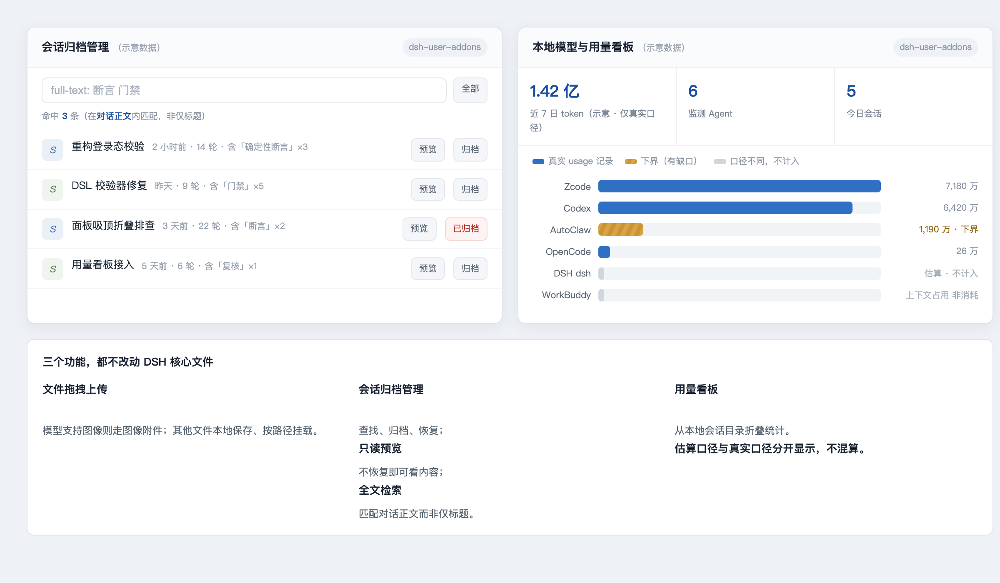

# dsh-user-addons

[English](README.md) | 中文

面向 [DeepSeek Harness](https://github.com/deepseek-ai/deepseek-harness) 的社区 Web 插件。

这个包是一个独立于 DSH 核心代码的双端插件，同时提供 Host 半侧和 Web 浏览器半侧。

## 界面



*（界面示意稿——仅示意布局与配色语义；图中所有数值均为占位示意，非真实测量值。）*

## 功能

- 在 Web 对话输入区拖入或选择文件。模型支持图片时直接附加图片；其他文件保存到本地并附加路径。
- 归档会话管理：查找、归档、恢复，以及 1.3.0 新增的只读预览（不必恢复即可看会话内容）与全文搜索（匹配会话正文而不只是标题）。
- 本地模型与 token 用量面板，扫描 `~/.dsh/sessions` 生成统计。
- 图片能力检测接口，帮助 Web 客户端选择附件处理方式。

## 要求

- 已启用客户端模块加载器的 DSH Web profile。
- Node.js 22.19 或更高版本，与当前 DSH 开发基线一致。

## 安装

**本包没有发布到 npm。** registry 上不存在 `@yur0918/dsh-user-addons`，按包名
安装会直接404。它是一个**本地profile 插件**：把源码目录软链到 profile 的
`node_modules`，再往profile patch 层插一行，profile 启动时自动加载。

在本仓库的 clone 目录下执行：

```bash
# 1. 软链到 profile 的 node_modules
ln -s "$PWD" ~/.dsh/profiles/node_modules/dsh-user-addons

# 2. 往 web profile 的 patch 层插入加载行
#    （追加到 ~/.dsh/profiles/web/cordis.patch.yml）
cat >> ~/.dsh/profiles/web/cordis.patch.yml <<'YAML'

- insert:
    - id: user-addons
      name: 'dsh-user-addons'
YAML

# 3. 重启 Web profile，使其重新发现包元数据与 lib/client.js
launchctl kickstart -k gui/$(id -u)/com.deepseek.dsh

# 4. 验证
curl http://127.0.0.1:3080/addons/health
# → {"ok":true,"addon":"dsh-user-addons","version":"1.3.0"}
```

第 1、2 步是幂等的：重复执行只是重建软链并追加重复行，所以重装前先检查
是否已存在。卸载时删掉软链和 `- id: user-addons` 那一行，再重启 profile。

如果你用的是非默认的 `DSH_HOME`，把上面两处路径都指向那个 home。

本包声明的客户端入口：

```json
{
  "dsh": {
    "client": {
      "platform": "web",
      "inject": [
        "@deepseek-ai/dsh-client-locale"
      ]
    }
  }
}
```

执行包检查：

```sh
npm run check
```

## 本地接口

Host 半侧注册同源 `/addons/*` 接口：

- `GET /addons/health`
- `GET /addons/archive/list`
- `GET /addons/archive/preview`
- `POST /addons/archive/archive`
- `POST /addons/archive/restore`
- `GET /addons/image-capability`
- `POST /addons/upload`
- `GET /addons/usage/summary`

上传大小上限为 100 MiB（`lib/index.js` 中的 `UPLOAD_LIMIT_BYTES`），文件名会在写入 DSH home 下的目录前进行清理。用量数据只从本地 DSH 会话日志读取；插件本身不发起网络请求。

## 开发

由于 DSH Web Host 会提供构建后的客户端 bundle，`lib/client.js` 会随包提交。请保持 Host 和 Client 半侧与所使用的 DSH 版本兼容，并在发布前执行 `npm run check`。

不要提交会话日志、上传文件、凭据、生成的任务状态或备份文件。

## 许可证

MIT
